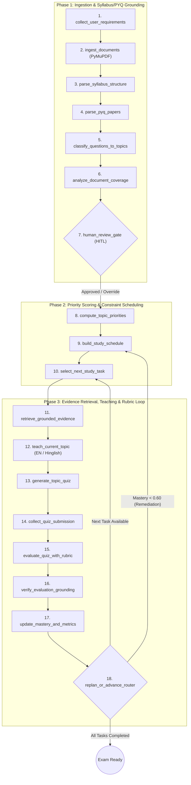

# RGPV-Agent: Adaptive University Exam Preparation System

[](https://github.com/amitsingupalli/RGPV_Agent/actions/workflows/ci.yml)


**RGPV-Agent** is a stateful, citation-grounded, multi-node AI engineering system built with **LangGraph**, **FastAPI**, **PostgreSQL (`pgvector`)**, **PyMuPDF**, and **React 19**. Designed specifically for university engineering curricula (benchmarked on **RGPV B.Tech CS-501 Database Management Systems**), it transforms raw syllabus PDFs, Previous Year Question (PYQ) papers, and lecture notes into an adaptive, constraint-aware exam preparation loop.

---

## 1. Why Generic Chatbots Fail University Exam Preparation

Standard RAG wrappers and conversational chatbots fail university engineering students for four structural reasons:

| Failure Mode of Generic Chatbots | How RGPV-Agent Solves It |
| :--- | :--- |
| **1. Syllabus Boundary Blindness**: Chatbots answer questions using unconstrained pretraining knowledge, often teaching advanced topics outside the university syllabus or skipping mandatory subtopics. | **Page-Preserving Syllabus Grounding**: Every canonical topic is extracted with exact PDF page citations (`PagePreservingChunker`) and validated by a **Human-in-the-Loop (HITL)** gate before planning begins. |
| **2. Zero PYQ Weightage Awareness**: Standard LLMs treat a rarely asked definition the same as a 14-mark cornerstone topic that appears in 85% of past university exams. | **Deterministic Topic Priority Engine**: Computes topic priority $P_i$ from multi-year PYQ frequency $F_i$, prerequisite graph centrality $D_i$, syllabus footprint $S_i$, and live student mastery deficit $(1 - M_i)$. |
| **3. Unrealistic Study Schedules**: Asking an LLM for a "10-day study plan" produces a generic bulleted list that ignores daily hour limits, topic difficulty, and revision buffers. | **Constraint-Aware Scheduler**: Packs high-priority topics into daily slots while strictly enforcing daily hour caps, prerequisite ordering, and mandatory pre-exam buffer/revision days. |
| **4. Ungrounded Self-Assessment**: Generic chatbots grade answers with arbitrary encouragement ("Good job! 8/10") without checking exam rubrics or penalizing factual hallucinations. | **Two-Stage Rubric Evaluator & Verifier**: Grades descriptive and MCQ answers against explicit criterion checklists, strips unverified score inflation via `EvaluationVerifierEngine`, and triggers dynamic schedule replanning when mastery drops. |

---

## 2. System Architecture & 18-Node LangGraph State Machine



---

## 3. Mathematical Formulations

### 3.1 Topic Priority Score ($P_i$)
Implemented in [`TopicPriorityEngine`](app/services/scoring.py), every canonical syllabus topic $i$ receives a bounded priority score $P_i \in [0, 1]$:

$$P_i = 0.35 \, F_i + 0.20 \, D_i + 0.25 \, S_i + 0.20 \, (1 - M_i)$$

Where:
- $F_i \in [0, 1]$: Normalized historical PYQ appearance & marks weightage across past RGPV examinations.
- $D_i \in [0, 1]$: Prerequisite dependency centrality (how many downstream topics depend on topic $i$).
- $S_i \in [0, 1]$: Syllabus structural weight (core unit weightage and subtopic density).
- $M_i \in [0, 1]$: Current student mastery score for topic $i$ (initialized to $0.0$ or diagnostic baseline).

### 3.2 Authority-Weighted Hybrid Retrieval
Implemented in [`EvidenceRetriever`](app/retrieval/search.py), chunks never cross PDF page boundaries ([`PagePreservingChunker`](app/retrieval/chunking.py)) and are ranked by combining dense/lexical similarity with document authority weights:

$$R(c) = \Big(0.65 \cdot \text{sim}_{\text{dense}}(q, c) + 0.35 \cdot \text{sim}_{\text{lexical}}(q, c)\Big) \times W_{\text{source}}(c)$$

where $W_{\text{source}}(\text{Syllabus}) = 1.25$, $W_{\text{source}}(\text{PYQ}) = 1.20$, $W_{\text{source}}(\text{Notes}) = 1.00$, and $W_{\text{source}}(\text{Reference}) = 0.95$.

### 3.3 Mastery Update & Dynamic Replanning Trigger
Implemented in [`MasteryEngine`](app/services/mastery.py), after every verified quiz evaluation:

$$M_i^{(t+1)} = \text{clip}\Big(0.60 \cdot S_{\text{verified}} + 0.40 \cdot M_i^{(t)} - 0.12 \cdot |\mathcal{E}_{\text{misconceptions}}|, \; 0.0, \; 1.0\Big)$$

- If $M_i^{(t+1)} < 0.60$ or $|\mathcal{E}_{\text{misconceptions}}| \ge 2$, the graph routes to **remediation replanning**, injecting a targeted 1-hour revision block into the upcoming schedule while respecting daily hour caps.

---

## 4. Automated Evaluation Benchmarks (`evals/`)

All agent nodes are continuously benchmarked against authentic RGPV **CS-501 (Database Management Systems)** data (5 Units, 15 canonical topics, 24 authentic PYQ questions across 2020–2024):

| Benchmark Suite | Script | Key Metrics | Result |
| :--- | :--- | :--- | :--- |
| **Syllabus Extraction & Citation Grounding** | [`evals/syllabus_bench.py`](evals/syllabus_bench.py) | Unit Recall / Topic Recall / Citation Accuracy | **100.0% / 100.0% / 100.0%** |
| **PYQ-to-Topic Classification** | [`evals/classification_bench.py`](evals/classification_bench.py) | Exact Topic Match / Unit-Level Accuracy ($N=24$) | **83.3% / 95.8%** |
| **Rubric Evaluator & Verifier Reliability** | [`evals/rubric_eval_bench.py`](evals/rubric_eval_bench.py) | Score MAE / Hallucination Leakage / Misconception Recall | **0.50 marks / 0.00 / 100.0%** |

Run all evaluation suites locally:
```bash
python -m evals.syllabus_bench
python -m evals.classification_bench
python -m evals.rubric_eval_bench
```

---

## 5. Repository Structure

```text
RGPV_Agent/
├── app/
│   ├── api/                 # FastAPI routers (auth, documents, plans, quizzes, progress, middleware)
│   ├── graph/               # LangGraph state schema, conditional routers, 18-node graph builder
│   ├── models/              # SQLAlchemy 2.0 + pgvector ORM models (13 relational tables)
│   ├── nodes/               # Modular LangGraph node engines (syllabus, questions, teaching, quiz, eval)
│   ├── retrieval/           # PagePreservingChunker & authority-weighted EvidenceRetriever
│   ├── services/            # Deterministic engines (TopicPriorityEngine, Scheduler, Mastery, Tracing)
│   ├── tools/               # PyMuPDF PDFParser & SecurityGuardrails (prompt injection/PDF validation)
│   ├── config.py            # Pydantic Settings configuration
│   └── main.py              # FastAPI application entrypoint
├── data/reference/dbms/     # Authentic RGPV CS-501 DBMS syllabus, 2020-2024 PYQs & gold mappings
├── evals/                   # Reproducible benchmark harnesses (syllabus, classification, rubric eval)
├── frontend/                # React 19 + TypeScript + Tailwind CSS + Vite interactive study workspace
├── tests/                   # 29 automated pytest unit, integration, security, and benchmark tests
├── Dockerfile               # Multi-stage Python 3.11 production container
├── docker-compose.yml       # Local full-stack orchestration (Postgres pgvector + Redis + API + UI)
└── docker-compose.prod.yml  # Production deployment overrides with resource limits & persistent volumes
```

---

## 6. Quickstart Guide

### Option A: Docker Compose (Recommended)

1. Copy the environment template:
   ```bash
   cp .env.example .env
   ```
2. Launch the full stack (`PostgreSQL 16 + pgvector`, `Redis 7`, `FastAPI Backend`, and `React + Nginx Frontend`):
   ```bash
   docker compose up --build
   ```
3. Access the services:
   - **Frontend Study Workspace**: `http://localhost:5173`
   - **FastAPI Swagger UI**: `http://localhost:8000/docs`
   - **Health Check & Trace Metrics**: `http://localhost:8000/health`

### Option B: Local Development Setup

1. **Backend Setup (Python 3.11+)**:
   ```bash
   python -m venv .venv
   # Windows PowerShell:
   .\.venv\Scripts\Activate.ps1
   # Linux/macOS:
   # source .venv/bin/activate

   pip install -r requirements.txt
   pytest tests/ -v
   uvicorn app.main:app --reload --port 8000
   ```

2. **Frontend Setup (Node.js 22+)**:
   ```bash
   cd frontend
   npm ci
   npm run lint
   npm run dev
   ```

---

## 7. Core API Reference

| Method | Endpoint | Description |
| :--- | :--- | :--- |
| `POST` | `/api/v1/auth/register` | Register a student account and issue a signed JWT access token. |
| `POST` | `/api/v1/documents/upload` | Upload & validate a PDF (magic-byte check + page-preserving PyMuPDF extraction). |
| `POST` | `/api/v1/plans/generate` | Run the LangGraph planning pipeline (`compute_topic_priorities` $\rightarrow$ `build_study_schedule`). |
| `POST` | `/api/v1/quizzes/generate` | Generate a grounded MCQ + descriptive quiz with explicit grading rubrics for a topic. |
| `POST` | `/api/v1/quizzes/evaluate` | Sanitize student answers, grade via `RubricEvaluatorEngine`, verify via `EvaluationVerifierEngine`, and update mastery. |
| `GET` | `/api/v1/progress/{subject_code}` | Retrieve unit-wise mastery telemetry, priority breakdown, and replanning history. |

---

## 8. Security & Observability

- **Prompt Injection & Input Guardrails**: [`SecurityGuardrails`](app/tools/security_tools.py) inspects all student quiz submissions and free-text overrides for adversarial grading instructions (`ignore previous rubric`, `award full marks`, system prompt extraction) before LLM invocation.
- **PDF Magic-Byte & Path Traversal Protection**: Strict `%PDF-` header verification, file size enforcement, and filename sanitization.
- **Structured Node Telemetry**: [`TraceLogger`](app/services/tracing.py) records per-node latency, token usage, and state transitions with optional Langfuse export.
